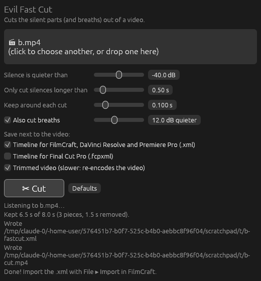

<h1 align="center">EVIL FAST CUT</h1>

<p align="center">
  <b>Cuts the silences (and breaths) out of your videos for <a href="https://github.com/storytold/filmcraft">FilmCraft</a>, the open-source video editor.</b>
</p>

<p align="center">
  <a href="https://discord.gg/AGfaBwNKfN"></a>
  <a href="https://www.youtube.com/@EvelopmentGames"></a>
  <a href="https://www.instagram.com/evelopmentgames/"></a>
  <a href="http://onee.page/evelopmentgames"></a>
  
</p>

<p align="center">
  <a href="https://ko-fi.com/evelynnevlmg"></a>
</p>
## What it does

Evil Fast Cut listens to your video, finds the parts with no sound, and gives you a timeline with
those parts already cut out. Tick **Also cut breaths** and it cuts the breaths between sentences
too. Your original file is never changed.

<p align="center"></p>

It saves, next to your video:

- **`MyVideo-fastcut.xml`**: in **FilmCraft**, open it with **File ▸ Import** and you get a new
  sequence, *MyVideo (fast cut)*, with every kept piece on the timeline, video and sound linked.
  You can still drag any cut open again if it took too much. The same file opens in
  **DaVinci Resolve** (File ▸ Import ▸ Timeline…) and **Premiere Pro** (File ▸ Import…).
- **`MyVideo-fastcut.fcpxml`** for **Final Cut Pro** (File ▸ Import ▸ XML…), if you tick it.
- **`MyVideo-cut.mp4`**, a trimmed copy of the video, if you tick it.

FilmCraft doesn't load plug-ins yet, so Evil Fast Cut is a small app you use next to it.

## Install

Get the download for your computer from the
[**Releases** page](https://github.com/Evelynnsrepos/EvilFastCut/releases/latest):

| Your system | Download |
|---|---|
| Windows | `evil-fastcut-windows.zip` |
| Mac (Intel or Apple chip) | `evil-fastcut-macos.zip` |
| Linux | `evil-fastcut-linux.zip` |
| Linux with Flatpak (Steam Deck, Fedora Silverblue, Bazzite…) | `evil-fastcut.flatpak` |

**Flatpak:** ffmpeg is already inside, so there's nothing else to install. Double-click the file
to install it in your software centre, or run `flatpak install --user evil-fastcut.flatpak`.
Evil Fast Cut then shows up in your apps menu. It can open videos in your home folder and on
external drives.

**Windows, Mac, Linux zip:**

1. Install **ffmpeg** (it reads the sound): [ffmpeg.org/download.html](https://ffmpeg.org/download.html).
   Windows: `winget install ffmpeg` · Mac: `brew install ffmpeg` · Linux: `sudo apt install ffmpeg`.
2. Unzip the download.
3. Open the app:
   - **Windows:** double-click `evil-fastcut-gui.exe`. If Windows SmartScreen warns you, click
     **More info ▸ Run anyway** (the app isn't signed).
   - **Mac:** move **Evil Fast Cut** to Applications. The first time, right-click it ▸ **Open** ▸
     **Open** (the app isn't signed, so macOS asks once).
   - **Linux:** double-click `evil-fastcut-gui`, or run `./evil-fastcut-gui`.

## Use it

1. Drop a video on the window, or click the big button to choose one.
2. Set how it cuts (hover over a slider for tips):
   - **Silence is quieter than** (default -40 dB): noisy room or hum: try -35. Very quiet voice: try -50.
   - **Only cut silences longer than** (0.5 s): lower it for a snappier, jump-cut style.
   - **Keep around each cut** (0.1 s): raise it if the starts or ends of words get clipped.
   - **Also cut breaths**, and how much quieter than your voice a breath is (12 dB). Lower that
     if loud breaths stay in.
3. Tick what to save, and click **✂ Cut**.
4. In FilmCraft: **File ▸ Import** and pick `MyVideo-fastcut.xml`.

Breath detection is a best guess: an "s" or "f" at the end of a word that trails off can look
like a breath, so check the cuts and drag them open in your editor if needed.

### Command line

The download also has `evil-fastcut`, the same thing for the terminal and for scripts
(Flatpak: `flatpak run --command=evil-fastcut io.github.evelynnsrepos.EvilFastCut ...`):

```sh
evil-fastcut MyVideo.mp4 --breaths --fcpxml MyVideo.fcpxml --video MyVideo-cut.mp4
```

| Option | Default | What it does |
|---|---|---|
| `--threshold DB` | `-40` | Anything quieter than this is silence. |
| `--min-silence SEC` | `0.5` | Only cut silences at least this long. |
| `--padding SEC` | `0.1` | Sound kept before and after each cut. |
| `--breaths` | off | Also cut breaths (quiet, voiceless sounds 0.15-1.2 s long between phrases). |
| `--breath-drop DB` | `12` | How much quieter than your speech a breath is. |
| `--xml FILE` | next to the video | Where to save the FilmCraft / Resolve / Premiere timeline. |
| `--fcpxml FILE` | off | Also save an FCPXML for Final Cut Pro. |
| `--video FILE` | off | Also render a trimmed video with ffmpeg. |

## Build from source (for developers)

```sh
cargo build --release   # → target/release/evil-fastcut-gui (window) and evil-fastcut (command line)
cargo test
```

Releases (Windows, universal macOS, Linux and the Flatpak in `flatpak/`) are built by
`.github/workflows/release.yml` when a `v*` tag is pushed, or from **Actions ▸ Release ▸ Run workflow**.

## Community

- Discord: https://discord.gg/AGfaBwNKfN
- YouTube: https://www.youtube.com/@EvelopmentGames
- Instagram: https://www.instagram.com/evelopmentgames/
- Like it? You can buy me a coffee on [Ko-fi](https://ko-fi.com/evelynnevlmg).
- Ideas and bugs: [open an issue](https://github.com/Evelynnsrepos/EvilFastCut/issues/new)

## License

MIT OR Apache-2.0, at your option.
